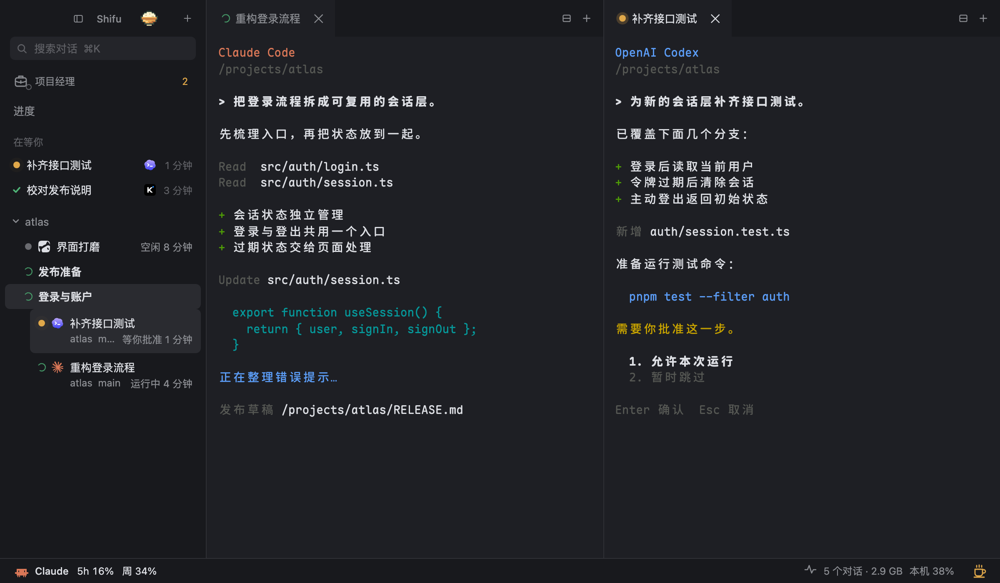
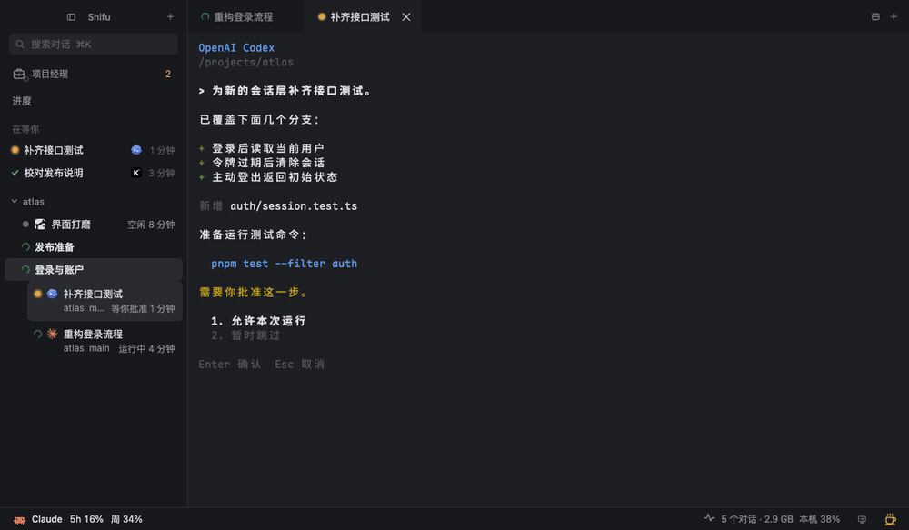

<p align="center"></p>

<h1 align="center">Shifu — a macOS coding agent workbench</h1>
<p align="center"><strong>Run Claude Code and Codex together. See which conversation needs you.</strong></p>
<p align="center">Group terminals by project, see live status, and keep sessions running after closing the window.</p>

<p align="center">
  <a href="LICENSE"></a>
  
  
  
</p>

<p align="center">
  <a href="README.md">中文</a> ·
  <a href="https://github.com/Longado/shifu/releases/tag/remote-v0.3.5-preview.1">Download preview</a> ·
  <a href="#quick-start">Quick start</a> ·
  <a href="#things-to-try">Things to try</a> ·
  <a href="#build-with-us">Build with us</a> ·
  <a href="docs/ARCHITECTURE.md">Architecture</a> ·
  <a href="docs/UPDATES.md#english">Updates</a>
</p>

When more agents are running, Shifu brings the conversations that need you together so you can stop checking terminals one by one.

**Each agent keeps its own terminal** · **Sessions keep running when the window closes** · **Tasks and layouts stay on your Mac**

> **Early version.** Primarily used on Apple Silicon Macs, available as an Apple Silicon preview package or source build, and not notarized. Claude, Codex, CodeBuddy and Kimi start in no-confirmation mode by default and can edit files and run commands without individual approval. Read the [launch instructions](#quick-start) and [known issues](#known-issues) before installing.

<p align="center"></p>
<p align="center"><sub>Simulated conversations in the current UI. Terminal content, conversation states and quotas are demo data. The interface is in Chinese.</sub></p>

## What it is

Shifu puts Claude Code, Codex, Kimi, CodeBuddy, Antigravity and optional StepFun in one macOS window. The sidebar groups conversations by project and task and shows who is running, waiting for approval or waiting for your reply. Each agent's own terminal stays on the right, with tabs you can drag into horizontal or vertical splits.

A dedicated tmux server owns the sessions; the desktop app displays and controls them. Closing or reopening the window does not end an agent. Tasks and split layouts return when you reopen it. The CLI also works on its own; see [Architecture](docs/ARCHITECTURE.md).

## How it works

| You… | It… |
|---|---|
| Create a task and select an agent, folder and model | Starts a session in the dedicated tmux server and receives that agent's state |
| An agent stops for approval or a reply | Marks its state in the sidebar and brings it into “waiting for you” |
| Press ⌘J or click a waiting conversation | Switches to its task and activates the original terminal |
| Drag a tab or choose a split direction from its menu | Arranges terminals side by side or above each other, preserving their own controls |
| Click a file path in a terminal | Opens it beside the conversation; Markdown can be edited and saved |
| Quit Shifu and reopen it | Agents keep running, and tasks and split layouts return |

Remote Mac sessions also support task grouping and search. Update the remote gateway for grouping; older gateways keep the ungrouped list. [Remote setup](docs/REMOTE-RELAY.en.md).

## Things to try

| Try | You'll see |
|---|---|
| Open two agents in one task, then right-click a tab → “移到右边” (move right) | The two agents' terminal interfaces sit side by side |
| Click a different conversation under “在等你” (waiting for you) | Its task opens and its terminal becomes active |
| Click “+” at the top left, then switch agents | One form for selecting the project, agent, model and thinking level; available choices come from your local setup |

<p align="center"></p>
<p align="center"><sub>UI recording with example sessions, terminal content and quotas.</sub></p>

## Quick start

[Download the Apple Silicon preview](https://github.com/Longado/shifu/releases/tag/remote-v0.3.5-preview.1), including the app, matching CLI and setup instructions. Ordinary sessions need no Rust; install tmux and sign into your agent separately. StepFun requires [Node/Pi and subscription-key setup](docs/STEPFUN.md#english).

### Option A: let your AI install it

Paste this into Claude Code or Codex:

```text
Install Shifu (https://github.com/Longado/shifu) for me. Read README.en.md and docs/INSTALL.en.md first.
1. Confirm this is an Apple Silicon Mac. Check that tmux and my chosen agent are installed and signed in; tell me what is missing.
2. Download the ZIP and SHA256SUMS from the same release linked in the README. Verify the download and extracted-file checksums. Use the packaged app and CLI by default; do not install Rust or build from source.
3. Follow the package instructions: put Shifu.app in ~/Applications and its matching bin/shifu in ~/.cargo/bin/shifu. For an existing installation, explain the brief quit needed for the upgrade and preserve the old app, CLI and sessions. Do not overwrite a running app.
4. Explain that the app is ad-hoc signed, not notarized, and starts agents in no-confirmation mode. Leave system security prompts to me. Configure StepFun, computer use, a remote relay or background follow-up only if I request them.
5. Help me choose a project and start my first agent conversation. On the first Codex launch, let me review its hooks before deciding whether to trust them.
```

### Option B: install it yourself

1. Download the ZIP and `SHA256SUMS` from the same release. Run `shasum -a 256 -c SHA256SUMS` in the download directory before extracting.
2. Put `Shifu.app` in `~/Applications`. For an existing installation, quit it and back up the old app and CLI first; use the app and CLI from the same package. In the extracted package directory, run:

   ```bash
   shasum -a 256 -c SHA256SUMS
   mkdir -p "$HOME/.cargo/bin"
   install -m 755 bin/shifu "$HOME/.cargo/bin/shifu"
   brew install tmux   # Skip if tmux is already installed
   ```

3. Open Shifu, choose a project and a signed-in agent, and start your first conversation. See the [installation guide](docs/INSTALL.en.md) for details; use [remote setup and pairing](docs/REMOTE-RELAY.en.md) when connecting another Mac.

- The app is ad-hoc signed and not notarized. If macOS blocks it, confirm the source and follow the app-specific prompt in System Settings → Privacy & Security.
- Codex asks you to review its hooks on first launch; read them before deciding whether to trust them. Keeping the CLI installation path avoids repeating setup.
- CLI only: `shifu` opens the workbench, `shifu new claude ~/proj` starts an agent, `shifu ls` lists sessions, and `shifu jump` opens a waiting conversation.

<details>
<summary>Build from source (developers)</summary>

Requires Rust and Node 20.19 or 22.12+.

```bash
brew install tmux
git clone https://github.com/Longado/shifu && cd shifu
cargo install --path .
cd app && npm install
npm run build:desktop -- --debug
# Open the app path printed by the build log in the managed .noindex cache
```

</details>

## Shortcuts

| Key | Does |
|---|---|
| Cmd+N | New task |
| Cmd+T | Add an agent to the current task |
| Cmd+W | Close the current panel (the agent keeps running) |
| Cmd+J | Jump to a waiting conversation, prioritizing approvals |
| Cmd+, | Appearance |
| Double-click a tab | Rename the agent; leave it empty to go back to the topic name |
| × on a tab | Choose to hide the tab while the agent keeps running, or end it; ending a running agent needs another confirmation |

## Connections

| What you want to do | Where to start |
|---|---|
| Use a Step Plan subscription with StepFun | [StepFun setup](docs/STEPFUN.md#english), with Node/Pi and your own key |
| View daily analysis | “每日分析” in the sidebar, with your own data sources and scheduling |
| Let agents inspect and operate local windows | [`shifu computer`](docs/COMPUTER-USE.md), an independent macOS helper |
| Let agents inspect pages, operate elements and manage tabs | [`shifu browser`](docs/BROWSER-USE.md), the pinned official Playwright CLI; supports isolated browsers and explicit attachment to existing Chrome |
| Enter another Mac's agent terminals from local Shifu | [Remote setup and pairing](docs/REMOTE-RELAY.en.md), using your own HTTPS relay |
| Return to a running session from your phone | [Phone access](docs/REMOTE.md), with a separately installed local service and private network |
| Keep long tasks running | [The cup menu](docs/STEAMCUP.md), with display modes, timers and closed-lid operation |
| See the overall state or relay a message | The project manager in the sidebar; relaying still requires your explicit instruction |
| Follow up on existing Codex sessions while away | [Bounded background follow-up](docs/AUTOPILOT.md#english), a script requiring reviewed goals, authorization and a deadline; also included in the preview package |

Conversation search, quotas and process usage live in the same window.

## Privacy

- Shifu provides no public hosted account and collects no telemetry. State, tasks and layouts stay on your Mac in `~/.shifu/app` (`~/.shifu` for the CLI). The local phone gateway listens on `127.0.0.1`; the new remote module can use your own HTTPS relay, with terminal data and requests in an end-to-end encrypted channel. Use a relay whose web client you trust. [Connection guide](docs/REMOTE-RELAY.en.md).
- Hooks for Claude Code, Codex and CodeBuddy are passed as launch arguments to the processes Shifu starts. Shifu does **not** change your `~/.claude/settings.json` or `~/.codex/config.toml`.
- **Kimi**: Kimi only reads its own config file, so Shifu writes hooks into `~/.kimi-code/config.toml`. Your own hooks stay, and the file is backed up to `config.toml.before-shifu` before the first write. Kimi sessions started outside Shifu call these hooks too, but they do nothing when the session was not started by Shifu.
- **Antigravity**: writes a `shifu-status` group in `~/.gemini/config/hooks.json`, keeping other groups. An existing file is backed up to `hooks.json.before-shifu` before its first update.
- Quotas: Claude's come from the data Claude hands to its statusLine (your own statusLine still shows as before); Codex's and CodeBuddy's are read from local session logs. Kimi's are queried using Kimi Code's current local login token without storing a separate copy. Antigravity usage comes from the signed-in `agy` CLI.
- Shifu uses its own tmux socket (`shifu-app`, `shifu` for the CLI) and leaves your usual tmux alone.
- Optional background follow-up sends necessary conversation and artifact content to the current Codex model. State, dispatched messages and receipts remain in the private run directory. See [operation and stopping boundaries](docs/AUTOPILOT.md#english).

## Known issues

- Only used on macOS (Apple Silicon). Linux and Windows are untried; notifications and drag and drop use macOS interfaces.
- If a `git` command hangs in a project folder (for example while macOS waits for a "Desktop folder" permission), the whole window freezes until git returns. The cause is known: the branch name is read with a lock held. Not fixed yet.
- A long path wrapped over three or more lines in a terminal can't be opened by clicking its later lines. Cause not found yet.
- Expired Kimi Code credentials prevent quota refreshes. Shifu keeps the last result until running Kimi refreshes its login.
- Phone access from outside the Mac requires a separately configured private network.
- Two optional local data sources are wired in: the progress page reads each project's `GOALS.md` and WorkBuddy's local tasks, and new-reply notifications first check a local judgement log from a tool called Jev. Without those files they are skipped.

## Also by the author

[OntoPoc](https://github.com/Longado/ontopoc) is an ontology tool for MCP / Claude: draft and check ontology definitions from business tables. [Docs](https://longado.github.io/ontopoc/).

## Build with us

**When many agents work at once, how does a person get called only when they are really needed?**

| If you like… | You could |
|---|---|
| Rust and concurrency | Move the branch-name git call out of the lock and give it a timeout, fixing the window freeze above |
| Terminals and xterm.js | Fix clicking long wrapped paths; add search inside a terminal |
| Wiring up agents | Gemini CLI, Cursor CLI and others: adapt their hooks so their state shows in the sidebar |
| Cross-platform work | Notifications, drag and drop and packaging on Linux |
| Interaction design | How to order "waiting for you", when to notify and when not to interrupt |

Issues and pull requests are welcome.

## Development

```bash
cargo test && cargo clippy -- -D warnings           # CLI and hooks
cargo build --release && bash scripts/smoke.sh       # smoke test: own socket, temp folder, fake agents
python3 tests/test_autopilot.py                     # isolated controller fixtures; no live dispatch
cd app && npm test && npm run build                  # frontend tests and type check
cd app/src-tauri && cargo test                       # app backend
cd app && npm run tauri dev                          # dev mode
```

Developer build caches default to 8 GiB / 3 idle days; see [build-cache documentation](docs/BUILD-CACHE.md).

Set `SHIFU_APP_HOME` and `SHIFU_APP_SOCKET` while developing so test data stays apart from the agents you are using.

## License

[MIT](LICENSE) © Yutai Lin. Third-party code and artwork are credited in [THIRD_PARTY_NOTICES.md](THIRD_PARTY_NOTICES.md).

The original SHIFU process plugin remains at [`process-plugin-final`](https://github.com/Longado/shifu/tree/process-plugin-final).
