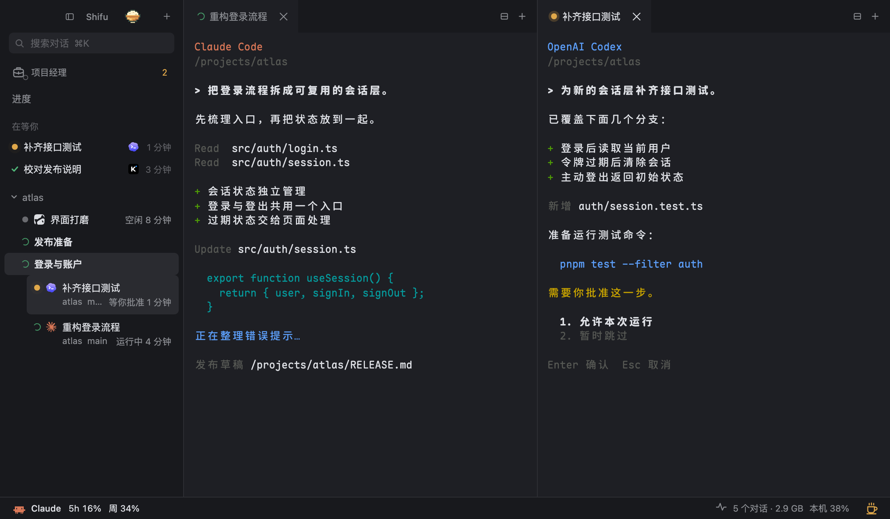

# Shifu

**Your agents. One workspace.**

Run Claude Code, Codex, Kimi, CodeBuddy and Antigravity side by side in a single macOS window.

[Get started](#get-started)　[中文](README.md)　[Architecture](docs/ARCHITECTURE.md)　[Updates](docs/UPDATES.md#english)

<br>



<sub>Current interface preview with demo conversations and simulated data. The interface is in Chinese.</sub>

### See what needs you

The sidebar shows who is running, waiting for approval, or asking a question. Press ⌘J to jump to the conversation that has waited longest.

### Spread out the work

Group conversations by project and drag tabs into horizontal or vertical splits. Each agent keeps its own terminal, models and controls. Open files and edit Markdown beside the conversation.

### Close the window. Pick up where you left off.

Sessions run in a dedicated tmux server. Agents keep working when the desktop window closes or restarts. Your tasks and split layouts return when you reopen it.

## Get started

Requires **macOS, Rust and Node.js**. Shifu currently builds from source; see the [installation guide](docs/INSTALL.en.md) for prerequisites and first-launch instructions.

```bash
brew install tmux
git clone https://github.com/Longado/shifu.git
cd shifu
cargo install --path . --locked
cd app && npm ci
npm run tauri build -- --debug
```

The app is built at `app/src-tauri/target/debug/bundle/macos/Shifu.app`.

Agents start in no-confirmation mode by default. The guide covers launch flags, system permissions and [known issues](docs/INSTALL.en.md#known-issues). You can also give your agent the [complete installation steps](docs/INSTALL.en.md).

## Add the connections you need

| What you want to do | Where to start |
|---|---|
| Let agents inspect and operate local windows | [`shifu computer`](docs/COMPUTER-USE.md), an independent macOS helper |
| Return to a running session from your phone | [Phone access](docs/REMOTE.md), with a separately installed local service and private network |
| Keep long tasks running | [The cup menu](docs/STEAMCUP.md), with display modes, timers and closed-lid operation |

The project manager, conversation search, quotas and process usage live in the same window. Meal ordering is an optional bridge to a local service and accounts you configure.

## Docs and contributions

[Installation and shortcuts](docs/INSTALL.en.md)　[Architecture and code](docs/ARCHITECTURE.md)　[Privacy and data](docs/INSTALL.en.md#privacy)　[Latest changes](docs/UPDATES.md#english)

Shifu is still early and is primarily used on Apple Silicon Macs. Report issues on [GitHub](https://github.com/Longado/shifu/issues), or start with the [development guide](docs/INSTALL.en.md#development).

---

[MIT](LICENSE) © Yutai Lin. [Third-party notices](THIRD_PARTY_NOTICES.md). The original SHIFU process plugin remains at [`process-plugin-final`](https://github.com/Longado/shifu/tree/process-plugin-final).
