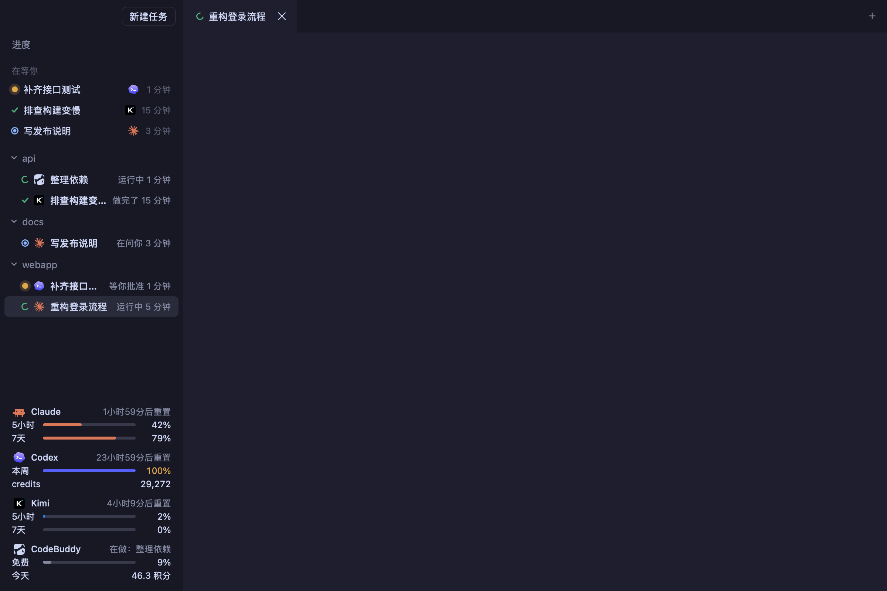

<p align="center"></p>

<h1 align="center">Shifu</h1>
<p align="center"><strong>Run a dozen coding agents at once and see at a glance which are working and which are waiting for you.</strong></p>
<p align="center">A macOS desktop workbench for people who run Claude Code, Codex, Kimi and CodeBuddy side by side.</p>

<p align="center">
  <a href="LICENSE"></a>
  
  
  
</p>

<p align="center">
  <a href="README.md">中文</a> ·
  <a href="docs/ARCHITECTURE.md">Architecture</a> ·
  <a href="#quick-start">Quick start</a> ·
  <a href="#build-with-us">Build with us</a>
</p>

With many agents running you end up flipping through terminal tabs: has this one finished, is that one stuck waiting for approval? Shifu puts them all in one window. The sidebar says "running", "waiting for approval", "asking you" or "done", and one click takes you there.

**Each agent keeps its own interface** · **Agents keep running when you close the window** · **State comes from the agents' own hooks, not from scraping the screen**

## November 11 update

- Antigravity quota monitoring uses the signed-in `agy` CLI (1.1.11+) and its [official `/usage` report](https://antigravity.google/docs/cli/commands/usage/). The footer shows used weekly and five-hour quotas for Gemini and Claude/GPT separately, with reset times and a five-minute refresh interval. Failed refreshes are marked stale or unavailable; Shifu does not store account credentials.

- Independent macOS computer use through `shifu computer`: inspect windows, capture screenshots, click, type, scroll and drag without running Orca. Grant permissions to Shifu's own helper; see the [setup and command guide](docs/COMPUTER-USE.md).
- Filter controls by text, limit output, wait for visible text, and check file path conditions. An explicit foreground fallback briefly reads the window and restores the previous app. A changed control value does not prove that a file operation completed.
- Choose an agent for the project manager, inspect conversation status and relay messages through local commands. Search active conversations, hide the sidebar and split panes vertically.
- A bottom bar shows usage and process memory, with controls to keep the system or display awake. File tabs support HTML and audio/video previews.

Finder inline renaming can still fail to change the file; prefer a file API and verify the paths. Background browser reads may return only toolbars; wait for specific body text. There is no browser DOM channel yet.

## What it is

Shifu is an agent workbench on top of tmux, in two layers:

- **The `shifu` CLI** starts agents in a dedicated tmux server, receives each agent's hooks and writes their state under `~/.shifu`. It works on its own too, with a sidebar pane inside tmux.
- **The Shifu desktop app** (`app/`, Tauri 2) shows each agent as a terminal tab you can split and drag, grouped into tasks. The sidebar shows state, with whoever is waiting on you at the top; the bottom left shows how much of each provider's quota is used.

tmux owns the agent processes; the app only attaches to them. Closing or restarting the app never interrupts a running agent. See [Architecture](docs/ARCHITECTURE.md) for the design.

> **Early version.** So far it has only been used daily on the author's own Mac (Apple Silicon, Homebrew tmux). There are no prebuilt packages; you build it yourself. **Shifu starts agents in no-confirmation mode by default** (Claude's `--dangerously-skip-permissions`, Codex's `--dangerously-bypass-approvals-and-sandbox`, Kimi's `--yolo`): they edit files and run commands without asking. If you don't want that, change `src/launch.rs` before building. Open problems are under [Known issues](#known-issues).

<p align="center"></p>
<p align="center"><sub>Screenshot with simulated agents and quotas; the terminal is empty. The interface is in Chinese.</sub></p>

## How it works

| You… | It… |
|---|---|
| Create a task and pick Claude / Codex / Kimi / CodeBuddy, a folder and a model | Starts the agent in the dedicated tmux server, with hooks attached to that launch only |
| Give the agent work | Its row turns into a spinning "running" |
| The agent stops to ask for approval | It turns into a blinking amber dot and moves into "waiting for you" at the top |
| The agent replies and waits for you | It turns into a blue ring; if the window is in the background you get a notification, and clicking it jumps to the agent |
| Press Cmd+J | Jumps to the agent that has waited longest |
| Drag a tab or a sidebar row onto another task | The agent now belongs to that task and its tab goes with it |
| Click a path or URL in a terminal | URLs open in the browser; paths can be previewed in Shifu, opened in their default app or shown in Finder |
| Quit Shifu and reopen it | The agents are still there and each task's split layout comes back |

## Things to try

| Try | You'll see |
|---|---|
| Start Claude, ask it to write a file, then switch to another tab | Its row goes from "running" to "asking you", and a row appears under "waiting for you" |
| Click "+" at the top right of a task and add a Codex | The task expands from one line into a heading with two rows; the two agents can sit side by side |
| Drag a tab to the right edge | The view splits in two |
| Drag a screenshot into a terminal | A copy of the screenshot is saved and its path is typed into the prompt |
| Cmd+, | Appearance: several colour presets, or your own colours |

## Quick start

### Option A: let your AI install it

Paste this into Claude Code or Codex:

```text
Install Shifu (https://github.com/Longado/shifu) for me. Read its README.en.md and docs/ARCHITECTURE.md first.
1. Check that this Mac has Homebrew tmux, Rust (cargo) and Node 20.19 or 22.12+; tell me how to install what is missing.
2. Clone the repo and run `cargo install --path .` in its root to install the shifu CLI (the app's hooks call ~/.cargo/bin/shifu).
3. In app/, run `npm install`, then `npm run tauri build -- --debug`.
4. Tell me where Shifu.app ended up, and remind me that it is not notarized (right-click "Open" the first time) and that it starts agents in no-confirmation mode.
5. Remind me that the first time I open Codex in Shifu, Codex asks whether to trust the hooks: choose "Trust all".
```

### Option B: install it yourself

```bash
brew install tmux
git clone https://github.com/Longado/shifu && cd shifu
cargo install --path .                      # the shifu CLI, into ~/.cargo/bin
cd app && npm install
npm run tauri build -- --debug              # builds src-tauri/target/debug/bundle/macos/Shifu.app
open src-tauri/target/debug/bundle/macos/Shifu.app
```

- The app is ad-hoc signed and not notarized. If macOS blocks it the first time, right-click it in Finder and choose "Open".
- The first time you start Codex in Shifu it shows "Hooks need review"; choose **Trust all and continue**. It won't ask again as long as the `shifu` install path stays the same.
- CLI only: `shifu` opens the workbench, `shifu new claude ~/proj` starts an agent, `shifu ls` lists them, `shifu jump` goes to the one that has waited longest.

## Shortcuts

| Key | Does |
|---|---|
| Cmd+N | New task |
| Cmd+T | Add an agent to the current task |
| Cmd+W | Close the current panel (the agent keeps running) |
| Cmd+J | Jump to the agent that has waited longest |
| Cmd+, | Appearance |
| Double-click a tab | Rename the agent; leave it empty to go back to the topic name |
| × on a tab | End the agent; asks once more if it is still working |

## Privacy

- Shifu has no server and collects nothing. State, tasks and layouts live on your Mac in `~/.shifu/app` (`~/.shifu` for the CLI).
- Hooks for Claude Code, Codex and CodeBuddy are passed as launch arguments to the processes Shifu starts. Shifu does **not** change your `~/.claude/settings.json` or `~/.codex/config.toml`.
- **Kimi is the exception**: Kimi only reads its own config file, so Shifu writes 7 hooks into `~/.kimi/config.toml`. Your own hooks stay, and the file is backed up to `config.toml.before-shifu` before the first write. Kimi sessions started outside Shifu call these hooks too, but they do nothing when the session was not started by Shifu.
- Quotas: Claude's come from the data Claude hands to its statusLine (your own statusLine still shows as before); Codex's and CodeBuddy's are read from local session logs; Kimi's are fetched from Kimi's server using Kimi's own login. Shifu never reads or stores any token.
- Shifu uses its own tmux socket (`shifu-app`, `shifu` for the CLI) and leaves your usual tmux alone.

## Known issues

- Only used on macOS (Apple Silicon). Linux and Windows are untried; notifications and drag and drop use macOS interfaces.
- If a `git` command hangs in a project folder (for example while macOS waits for a "Desktop folder" permission), the whole window freezes until git returns. The cause is known: the branch name is read with a lock held. Not fixed yet.
- A long path wrapped over three or more lines in a terminal can't be opened by clicking its later lines. Cause not found yet.
- Kimi's quota uses Kimi's internal login module. If Kimi renames it, the Kimi quota may stay blank.
- Two optional local data sources are wired in: the progress page reads each project's `GOALS.md` and WorkBuddy's local tasks, and new-reply notifications first check a local judgement log from a tool called Jev. Without those files they are skipped.

## Build with us

**When many agents work at once, how does a person get called only when they are really needed?**

| If you like… | You could |
|---|---|
| Rust and concurrency | Move the branch-name git call out of the lock and give it a timeout, fixing the window freeze above |
| Terminals and xterm.js | Fix clicking long wrapped paths; add search inside a terminal |
| Wiring up agents | Gemini CLI, Cursor CLI and others: adapt their hooks so their state shows in the sidebar |
| Cross-platform work | Notifications, drag and drop and packaging on Linux |
| Interaction design | How to order "waiting for you", when to notify and when not to interrupt |

Issues and pull requests are welcome.

## Development

```bash
cargo test && cargo clippy -- -D warnings           # CLI and hooks
cargo build --release && bash scripts/smoke.sh       # smoke test: own socket, temp folder, fake agents
cd app && npm test && npm run build                  # frontend tests and type check
cd app/src-tauri && cargo test                       # app backend
cd app && npm run tauri dev                          # dev mode
```

Set `SHIFU_APP_HOME` and `SHIFU_APP_SOCKET` while developing so test data stays apart from the agents you are using.

## About this repository

This repository used to hold the SHIFU process plugin (scaling an AI coding agent's process depth with task risk). That version is kept at the tag [`process-plugin-final`](https://github.com/Longado/shifu/tree/process-plugin-final); from this commit on the repository holds the workbench.

## License

[MIT](LICENSE) © Yutai Lin. The pixel Claude mascot follows the drawing in Anthropic's claude-desktop-buddy (MIT); see [THIRD_PARTY_NOTICES.md](THIRD_PARTY_NOTICES.md).
