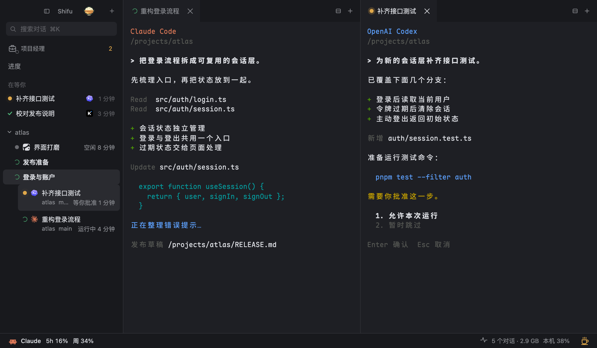

# Shifu

**多个 Agent，一张工作台。**

Claude Code、Codex、Kimi、CodeBuddy 和 Antigravity，在 macOS 的同一个窗口里并行工作。

[开始使用](#开始使用)　[English](README.en.md)　[架构](docs/ARCHITECTURE.md)　[更新记录](docs/UPDATES.md)

<br>



<sub>当前界面预览，使用演示会话与模拟数据。</sub>

### 该你接手的，排在前面

谁在运行、谁在等批准、谁有问题要问你，侧栏直接显示。按一下 ⌘J，就能跳到等你最久的会话。

### 把正在做的任务摊开

按项目组织会话，拖动标签左右或上下分屏。每个 Agent 保留自己的终端、模型和操作方式，文件与 Markdown 可以在对话旁边打开、编辑。

### 关掉窗口，回来接着做

会话运行在独立的 tmux 服务里。关闭或重开桌面窗口，Agent 继续工作；再回来时，任务与分屏布局一起恢复。

## 开始使用

需要 **macOS、Rust 和 Node.js**。当前提供源码构建，详细前提与首次启动说明见[安装指南](docs/INSTALL.md)。

```bash
brew install tmux
git clone https://github.com/Longado/shifu.git
cd shifu
cargo install --path . --locked
cd app && npm ci
npm run tauri build -- --debug
```

生成的应用位于 `app/src-tauri/target/debug/bundle/macos/Shifu.app`。

Agent 默认以免确认模式启动；安装指南列出了启动参数、系统权限和[已知问题](docs/INSTALL.md#已知问题)。也可以把[完整安装步骤](docs/INSTALL.md)交给你的 Agent 执行。

## 按需要，接上更多入口

| 想做的事 | 入口 |
|---|---|
| 让 Agent 查看和操作本机窗口 | [`shifu computer`](docs/COMPUTER-USE.md)，独立的 macOS 辅助程序 |
| 从手机接回正在运行的会话 | [手机连接](docs/REMOTE.md)，需要单独安装本机服务与配置私有网络 |
| 让长任务继续运行 | [杯子菜单](docs/STEAMCUP.md)，屏幕模式、定时与合盖运行 |

项目经理、会话搜索、额度与进程占用，也都在同一个窗口里。点餐是可选本机桥接，服务和账号由本人配置。

## 文档与参与

[安装与快捷键](docs/INSTALL.md)　[架构与代码](docs/ARCHITECTURE.md)　[隐私与数据](docs/INSTALL.md#隐私)　[最近更新](docs/UPDATES.md)

Shifu 仍在早期阶段，主要在 Apple Silicon Mac 上使用。欢迎通过 [Issues](https://github.com/Longado/shifu/issues) 提交使用问题，或从[开发说明](docs/INSTALL.md#开发)开始贡献。

---

[MIT](LICENSE) © Yutai Lin。[第三方许可](THIRD_PARTY_NOTICES.md)。早期 SHIFU 流程插件保留在 [`process-plugin-final`](https://github.com/Longado/shifu/tree/process-plugin-final)。
