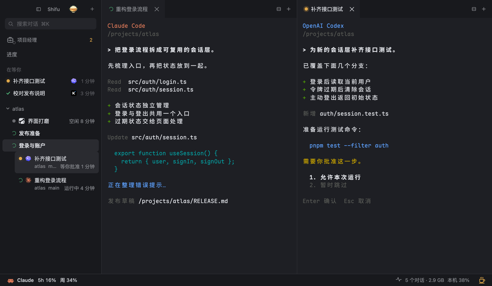
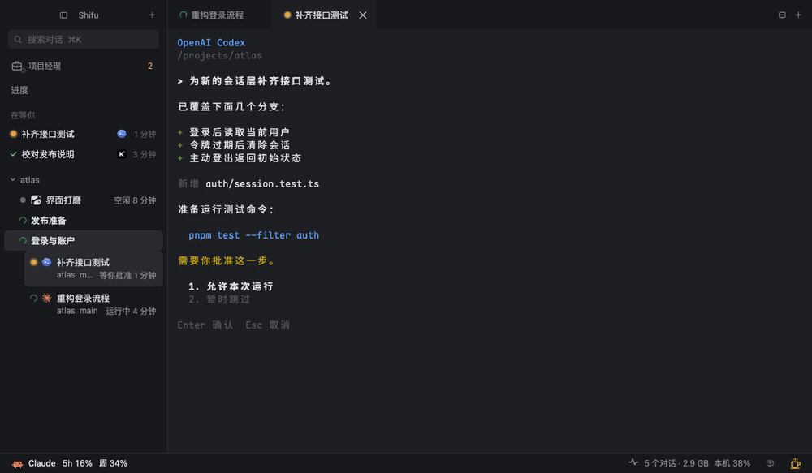

<p align="center"></p>

<h1 align="center">Shifu — macOS 编程 Agent 工作台</h1>
<p align="center"><strong>Claude Code、Codex 同时工作，一眼找到需要你接手的会话。</strong></p>
<p align="center">按项目管理终端、查看运行状态，关掉窗口后会话继续运行。</p>

<p align="center">
  <a href="LICENSE"></a>
  
  
  
</p>

<p align="center">
  <a href="README.en.md">English</a> ·
  <a href="https://github.com/Nalu-Lab/shifu/releases/tag/remote-v0.3.9-preview.1">下载预发布版</a> ·
  <a href="#快速开始">快速开始</a> ·
  <a href="#可以试试这些">可以试试</a> ·
  <a href="#一起做">一起做</a> ·
  <a href="docs/ARCHITECTURE.md">架构</a> ·
  <a href="docs/UPDATES.md">更新记录</a>
</p>

Agent 多起来以后，不用逐个翻终端：Shifu 把需要你接手的会话排在一起。

**各家终端原样保留** · **关掉窗口继续运行** · **任务与布局保存在本机**

> **早期版本。** 目前主要在 Apple Silicon Mac 上使用，可下载 Apple Silicon 预发布包或从源码编译，应用尚未公证。Shifu 默认以免确认模式启动 Claude、Codex、CodeBuddy、Kimi 和 Qwen Code，它们修改文件、执行命令时不会逐项询问；安装前请读[启动说明](#快速开始)和[已知问题](#已知问题)。

<p align="center"></p>
<p align="center"><sub>这是模拟会话演示：界面来自当前版本，终端内容、会话状态与额度为演示数据。</sub></p>

## 是什么

Shifu 把 Claude Code、Codex、Kimi、CodeBuddy、Antigravity，以及可选的 StepFun、Qwen Code 放进同一个 macOS 窗口。左侧按项目和任务组织会话，显示谁在运行、谁在等批准、谁在等你回复；右侧是各家 Agent 自己的终端，可以拖动标签、左右或上下分屏。

会话由独立的 tmux 服务管理，桌面版只负责显示和操作。关掉或重开窗口不会结束 Agent；回来时恢复任务与分屏布局。命令行也能单独使用，设计见[架构说明](docs/ARCHITECTURE.md)。

## 它怎么工作

| 你…… | 它会…… |
|---|---|
| 新建任务，选 Agent、目录和模型 | 在专用 tmux 服务里启动会话，接收对应 Agent 的状态 |
| Agent 停下来等待批准或回复 | 在侧栏标记状态，放到顶部「在等你」 |
| 按 ⌘J，或点击一条等待中的会话 | 跳到对应任务，激活原来的终端 |
| 拖动标签，或右键选择分屏方向 | 将终端左右或上下并排，保留各自的交互方式 |
| 点开终端里的文件路径 | 支持中文编码、Markdown／文件标签、带空格或括号的文件名与折行长路径；可在 Shifu、默认程序或 Finder 中打开 |
| 关掉 Shifu 再打开 | Agent 继续运行，任务与分屏布局恢复 |

远程 Mac 的会话同样可按 Task 分组和搜索；需更新远端网关，旧网关仍显示未分组列表。[远程设置](docs/REMOTE-RELAY.md)。

不打开窗口也能指挥远端：`shifu remote` 命令行可列出会话、发消息、按键回答确认框、等它做完再取回结果，`shifu remote mcp` 把这些交给 Claude Code、Codex 等 Agent 调用。[命令行与 MCP](docs/REMOTE-RELAY.md#命令行与-mcp)。

## 可以试试这些

| 试试 | 会看到 |
|---|---|
| 同一任务开两个 Agent，右键其中一个标签 →「移到右边」 | 两个 Agent 各自的终端界面左右并排 |
| 点击顶部「在等你」里的另一条会话 | 切到它所在的任务，并激活对应终端 |
| 点左上角「+」，再切换 Agent | 在同一张表单选择项目、Agent、模型与思考档位；选项以本机实际可用内容为准 |

<p align="center"></p>
<p align="center"><sub>界面操作录屏，使用示例会话、终端内容与额度。</sub></p>

## 快速开始

[下载 Apple Silicon 预发布包](https://github.com/Nalu-Lab/shifu/releases/tag/remote-v0.3.9-preview.1)，内含 App、匹配 CLI 和安装说明。普通会话无需 Rust；另备 tmux 和已登录的 Agent 即可。StepFun 需[单独设置 Node/Pi 和订阅密钥](docs/STEPFUN.md)。

### 方式 A：让你的 AI 帮你装

把下面这段贴进 Claude Code 或 Codex：

```text
帮我安装 Shifu（https://github.com/Nalu-Lab/shifu）。先读 README 和 docs/INSTALL.md。
1. 确认当前 Mac 使用 Apple Silicon，检查 tmux 和我要使用的 Agent 是否已安装、登录；缺什么先告诉我。
2. 下载 README 指向的同一 Release 中的 ZIP 和 SHA256SUMS，核对下载文件及解压后的文件校验。默认使用现成 App 和 CLI，无需安装 Rust 或从源码编译。
3. 按包内说明，将 Shifu.app 放到 ~/Applications，将同包 bin/shifu 装到 ~/.cargo/bin/shifu。将 ~/.cargo/bin 加入当前终端 PATH，验证 shifu --help，并说明新终端可用完整路径运行。已有 Shifu 时先说明升级需要短暂退出，保留旧 App、CLI 和会话；不要覆盖运行中的 App。
4. 提醒我它是临时签名、未公证，且默认用免确认模式启动 Agent；系统安全提示由我处理。StepFun、电脑操作、远程中继和后台托管仅在我要求时另行配置。
5. 打开后带我选一个项目、创建第一条 Agent 对话；首次启动 Codex 时，让我检查它提示的 hooks 后决定是否信任。
```

### 方式 B：自己装

1. 下载同一 Release 的 ZIP 和 `SHA256SUMS`，先在下载目录执行 `shasum -a 256 -c SHA256SUMS`，再解压。
2. 已有 Shifu 时，先退出并备份旧 App 与 CLI；App 和 CLI 使用同一包的版本。先在解压后的包目录校验内容，再安装 CLI：

   ```bash
   shasum -a 256 -c SHA256SUMS
   mkdir -p "$HOME/Applications" "$HOME/.cargo/bin"
   install -m 755 bin/shifu "$HOME/.cargo/bin/shifu"
   rm -rf "$HOME/.cargo/bin/web" && ditto bin/web "$HOME/.cargo/bin/web"   # shifu web 的运行文件
   export PATH="$HOME/.cargo/bin:$PATH"
   brew install tmux   # 已有 tmux 时跳过
   ```

3. 校验通过后，将 `Shifu.app` 移到 `~/Applications`，再打开 Shifu，选择项目和已登录的 Agent，创建第一条对话。完整说明见[安装指南](docs/INSTALL.md)；连接另一台 Mac 时再看[远程安装与配对](docs/REMOTE-RELAY.md)。

- 应用采用临时签名，尚未公证；首次打开若被拦，确认来源后按「系统设置 → 隐私与安全性」中的对应提示处理。
- 第一次启动 Codex 会提示检查 hooks，请阅读后决定是否信任。CLI 安装路径保持不变时，无需每次重复设置。
- PATH 设置只对当前终端生效。新终端尚未配置该路径时，可运行 `"$HOME/.cargo/bin/shifu"`，或自行将该目录加入 shell 配置。
- 只想用命令行：`shifu` 打开工作台，`shifu new claude ~/proj` 开一个 Agent，`shifu ls` 列出会话，`shifu jump` 跳到等待处理的会话。

<details>
<summary>从源码构建（开发者）</summary>

需要 Rust，以及 Node 20.19 或 22.12 以上版本。

```bash
brew install tmux
git clone https://github.com/Nalu-Lab/shifu && cd shifu
cargo install --path .
cd app && npm install
npm run build:desktop -- --debug
# 按构建日志中的受管 .noindex App 路径打开
```

</details>

## 快捷键

| 键 | 作用 |
|---|---|
| Cmd+N | 新建任务 |
| Cmd+T | 在当前任务里加一个 agent |
| Cmd+W | 关闭当前面板（agent 不停） |
| Cmd+J | 跳到等待处理的会话，优先处理批准请求 |
| Cmd+, | 外观 |
| 双击标签 | 给这个 agent 改名，留空就用回话题名 |
| 点标签上的 × | 选择「收起，继续运行」或「结束」；运行中结束另有确认 |

## 功能入口

| 想做的事 | 入口 |
|---|---|
| 使用百炼 Token Plan 运行 Qwen Code | [Qwen 设置](docs/QWEN.md)，需另备 Qwen CLI 和自己的密钥；当前源码提供 |
| 记录 Git 工作区接续、恢复已退出的会话 | [`workspace` / `resume`](docs/WORKSPACES.md)，当前源码提供 |
| 使用 Step Plan 订阅运行 StepFun | [StepFun 设置](docs/STEPFUN.md)，需另备 Node/Pi 和自己的密钥 |
| 查看每日分析 | 左侧「每日分析」，数据来源按自己的环境配置；[定时触发与漏跑补偿](docs/DAILY-ANALYSIS.md) |
| 让 Agent 查看和操作本机窗口 | [`shifu computer`](docs/COMPUTER-USE.md)，使用独立的 macOS 辅助程序 |
| 让 Agent 读取网页、操作元素和标签页 | [`shifu browser`](docs/BROWSER-USE.md)，使用固定版本的官方 Playwright CLI，支持专用浏览器和显式连接已有 Chrome |
| 一次开启后后台接入现有 Chrome 任务页 | [Chrome 连接组件](docs/CHROME-BRIDGE.md)，最多三个准确绑定，免逐页点击，可全局暂停 |
| 让几个 Agent 同时查网页资料 | [`shifu web`](docs/WEB-POOL.md)，按本机空闲内存决定同时开几个，满了排队，查完自己释放 |
| 从本地 Shifu 进入另一台 Mac 的 Agent 终端 | [远程安装与配对](docs/REMOTE-RELAY.md)，使用自己的 HTTPS 中继 |
| 从手机接回正在运行的会话 | [手机连接](docs/REMOTE.md)，单独安装本机服务并配置私有网络 |
| 让长任务继续运行 | [杯子菜单](docs/STEAMCUP.md)，屏幕模式、定时与合盖运行 |
| 查看全局或在会话中传话 | 左侧「项目经理」；传话仍需本人明确授权 |
| 离开后按已批准目标跟进现有 Codex 会话 | [轻量后台托管](docs/AUTOPILOT.md)，脚本配置目标、授权与截止时间；新预发布包也包含该入口 |
| 给正在工作的原会话追加输入、查看本轮实际成果 | 当前源码支持持久输入队列和按回执统计的任务进度；停滞时提醒原总控调整。[配置与限制](docs/AUTOPILOT.md#追加输入与成果进度当前源码)；需配套更新 App/CLI，现有下载包尚未包含 |

会话搜索、额度和进程占用也在同一个窗口里。

## 隐私

- Shifu 不提供公共托管账号，不收集遥测。状态、任务、布局保存在本机 `~/.shifu/app`（命令行版在 `~/.shifu`）。本机手机入口监听 `127.0.0.1`；新远程模块可连接本人配置的 HTTPS 中继，端到端通道传输终端数据与操作请求，中继网页也应来自自己信任的服务器。[连接说明](docs/REMOTE-RELAY.md)。
- Claude Code、Codex、CodeBuddy 的 hooks 通过启动参数挂在 Shifu 开的那个进程上，**不改**你的 `~/.claude/settings.json`、`~/.codex/config.toml`。
- **Kimi**：Kimi 只认自己的配置文件，Shifu 会把 hooks 写进 `~/.kimi-code/config.toml`，你自己的 hook 原样保留，第一次写之前备份成 `config.toml.before-shifu`。在 Shifu 外面开的 Kimi 也会调用这些 hook，但它们发现不是 Shifu 开的就什么都不做。
- **Qwen Code**：使用独立的 `SHIFU_HOME/qwen` 配置与会话；密钥从环境、本人准备的本地文件或兼容密钥库取得，Shifu 不把密钥值写入生成设置。[配置说明](docs/QWEN.md)。
- **Antigravity**：会在 `~/.gemini/config/hooks.json` 写入 `shifu-status` 分组，保留其他分组；首次改写已有文件前备份为 `hooks.json.before-shifu`。
- 额度显示：Claude 的额度从它交给 statusLine 的数据里取（你自己的 statusLine 照常显示）；Codex 和 CodeBuddy 的额度读本机会话记录；Kimi 的额度复用 Kimi Code 本机有效登录令牌查询，不另存该令牌；Antigravity 通过当前登录的 `agy` 读取用量。
- Shifu 用自己的 tmux socket（`shifu-app`，命令行版是 `shifu`），不碰你原来的 tmux。
- 可选后台托管将必要的会话和文件内容交给当前 Codex 模型判断；状态、派发全文和回执保存在本轮私有目录。[使用与停止边界](docs/AUTOPILOT.md)。

## 已知问题

- 只在 macOS（Apple Silicon）上用过。Linux 和 Windows 没试过，通知、拖放这些用的是 macOS 的接口。
- Kimi Code 登录过期时不能刷新额度；会保留上次结果，运行 Kimi 更新登录后再刷新。
- 手机外网连接需要另行配置私有网络。
- 另外接了两个可选的本机数据源：进度页读各项目的 `GOALS.md` 和 WorkBuddy 的本地任务；新回复通知前会读一个叫 Jev 的本机判断日志。没有这些文件时自动跳过。

## 同一作者

[OntoPoc](https://github.com/Longado/ontopoc) 是给 MCP / Claude 用的 ontology tool：从业务表起草并核对本体定义。[文档站](https://longado.github.io/ontopoc/)。

## 一起做

**多个 agent 同时干活时，人怎么才能只在真正需要自己的时候被叫到？**

| 你喜欢…… | 可以贡献 |
|---|---|
| 终端、xterm.js | 终端里的搜索 |
| 接新的 agent | Gemini CLI、Cursor CLI 等：写 hooks 适配，把状态接进侧栏 |
| 跨平台 | Linux 上的通知、拖放和打包 |
| 交互设计 | 「在等你」怎么排、什么时候该发通知、什么时候不该打扰 |

欢迎提 issue 或 pull request。

## 开发

```bash
cargo test && cargo clippy -- -D warnings           # 命令行和 hooks
cargo build --release && bash scripts/smoke.sh       # 冒烟：专用 socket、临时目录、假 agent
python3 tests/test_autopilot.py                     # 后台托管：临时数据与隔离 CLI，不派发真实任务
cd app && npm test && npm run build                  # 前端单测和类型检查
cd app/src-tauri && cargo test                       # 桌面版后端
cd app && npm run tauri dev                          # 开发模式
```

开发构建缓存默认按 8 GiB / 3 天回收，详见[构建缓存说明](docs/BUILD-CACHE.md)。

开发时设 `SHIFU_APP_HOME`、`SHIFU_APP_SOCKET`，测试数据就不会和正在用的混在一起。

## 许可证

[MIT](LICENSE) © Yutai Lin。第三方代码与素材的来源见 [THIRD_PARTY_NOTICES.md](THIRD_PARTY_NOTICES.md)。

早期 SHIFU 流程插件保留在 [`process-plugin-final`](https://github.com/Nalu-Lab/shifu/tree/process-plugin-final)。
